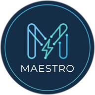

🇬🇧 English | [🇩🇪 Deutsch](README.de.md)

  

<h1 align="center">E3DC Maestro</h1>

  <strong>Your E3DC. Clearly controlled — in Home Assistant.</strong> 
  Local · explainable · no cloud required 
  A GlowDash product

  
  
  
   
  
  

  

<em>Everything in the sidebar. No custom cards — desktop and phone.</em>

**E3DC Maestro** puts control, forecast and tariff under one roof: the Maestro Cockpit. You see what happens — and why.

> **📖 Handbook** — setup, cockpit, control logic and FAQ:  
> **[glowdash.de/maestro/docs](https://glowdash.de/maestro/docs/)**  
> (same chapter structure as Help `?` in the panel)

> **This project is donation-funded.** Maestro stays free and open source.  
> If it helps your home: [Donate via PayPal](https://www.paypal.com/paypalme/tommigraf) — thank you.

---

## What you get

| | |
|---|---|
| **Live energy flow** | PV, grid, house, battery and loads — plus daily balance |
| **48 h forecast** | Forward-looking charging and SoC trajectory |
| **Price plan & tariffs** | Dynamic tariffs, windows, grid charging — traceable |
| **Decision explained** | Why this rule phase is active |
| **Quick controls** | Reserve, pause, overrides in the panel |
| **Local** | Prioritised phases, curtailment guard, wallbox & heat-pump logic |

---

## Ready in three steps

Maestro needs **[E3DC RSCP](https://github.com/torbennehmer/hacs-e3dc)**. Without it there is no control.

### 1. Set up E3DC RSCP

Install and connect [torbennehmer/hacs-e3dc](https://github.com/torbennehmer/hacs-e3dc).

> **AI360 must be off.** Otherwise E3DC overrides external charge commands.

### 2. Install Maestro

**HACS (until HA 2026.10):** Custom repository `https://github.com/TommiG1/hacs-e3dc-maestro` → Integration → Download → restart.

**Marketplace (from HA 2026.11):** Settings → Marketplace → Maestro.

### 3. Open the Cockpit

Add the integration → **Maestro** in the sidebar. Onboarding included.

---

## More views

| Forecast | Price plan | Decision |
|:---:|:---:|:---:|
|  |  |  |

---

## Requirements

Home Assistant ≥ 2024.1 · E3DC RSCP running · tested with S10E / S10E Pro among others · PV forecast optional.

**Handbook:** [glowdash.de/maestro/docs](https://glowdash.de/maestro/docs/) · Website: [glowdash.de/maestro](https://glowdash.de/maestro/) · [Discussions](https://github.com/TommiG1/hacs-e3dc-maestro/discussions) · [Issues](https://github.com/TommiG1/hacs-e3dc-maestro/issues) · [Releases](https://github.com/TommiG1/hacs-e3dc-maestro/releases)

**E3DC Maestro** by Thomas Graf / GlowDash · Open Source ([AGPL-3.0](LICENSE)) · Built on [E3DC RSCP](https://github.com/torbennehmer/hacs-e3dc) by Torben Nehmer
