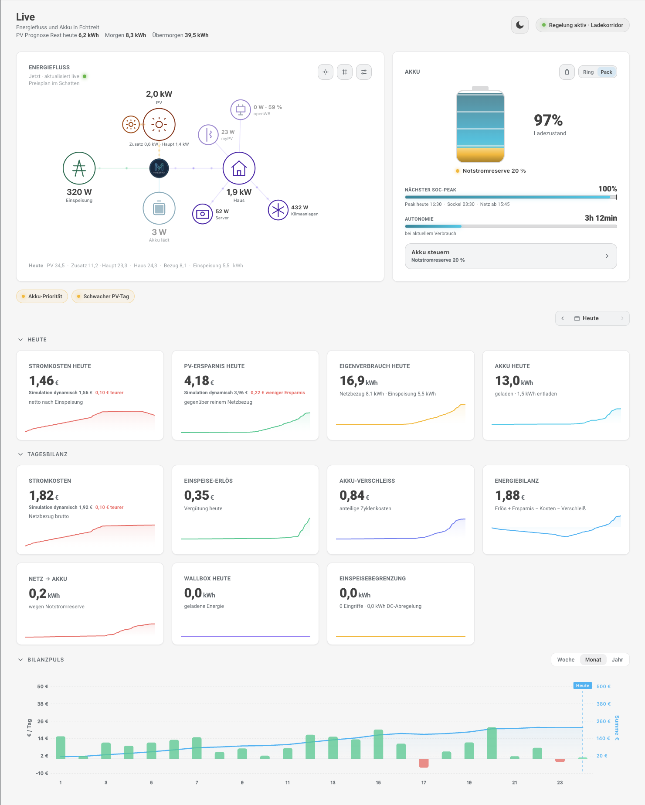
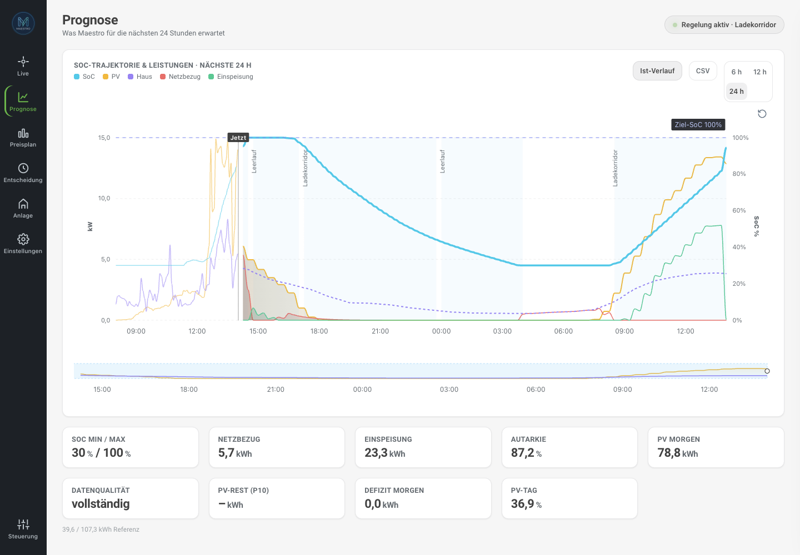
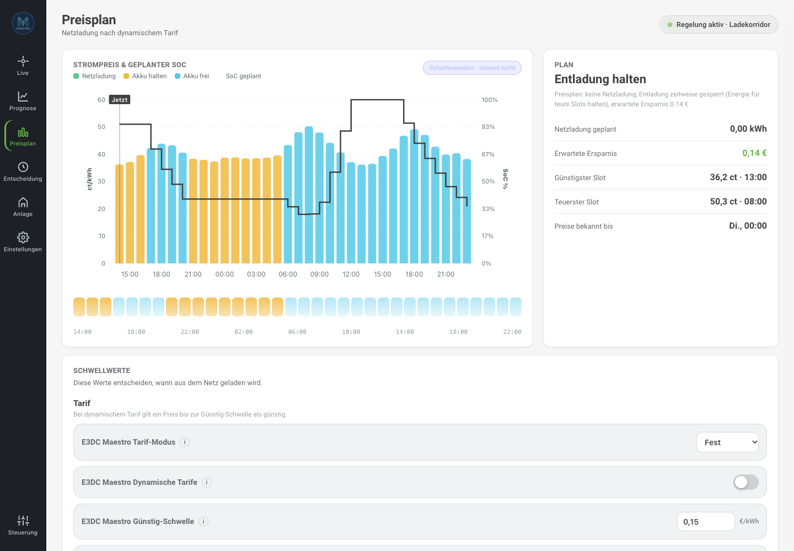
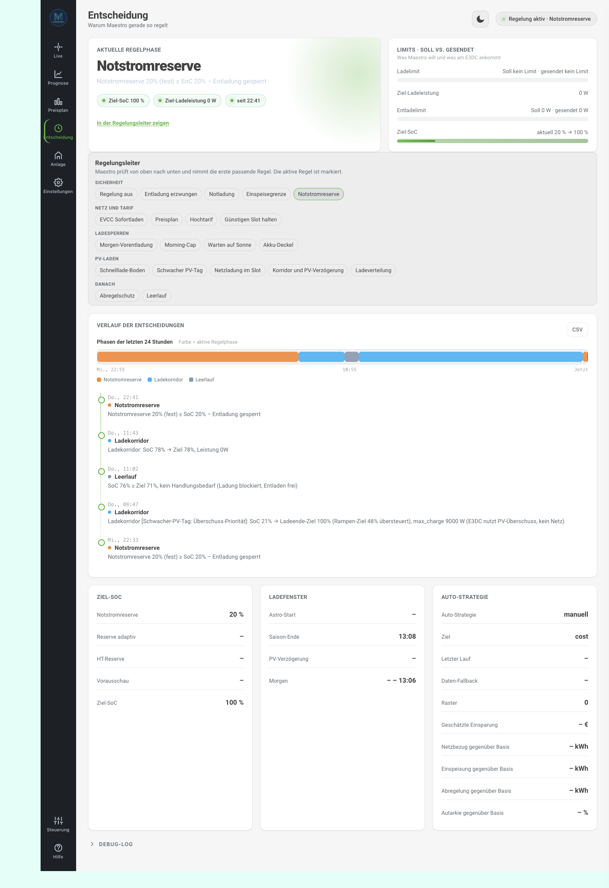
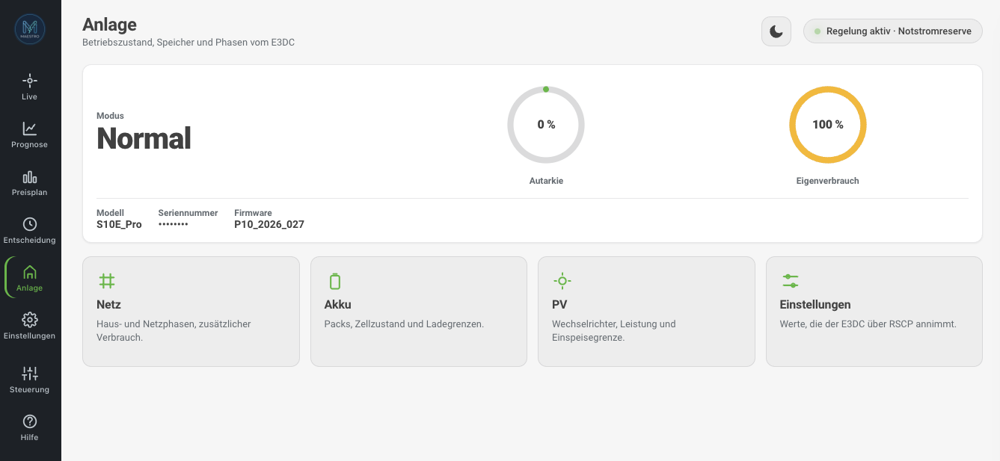
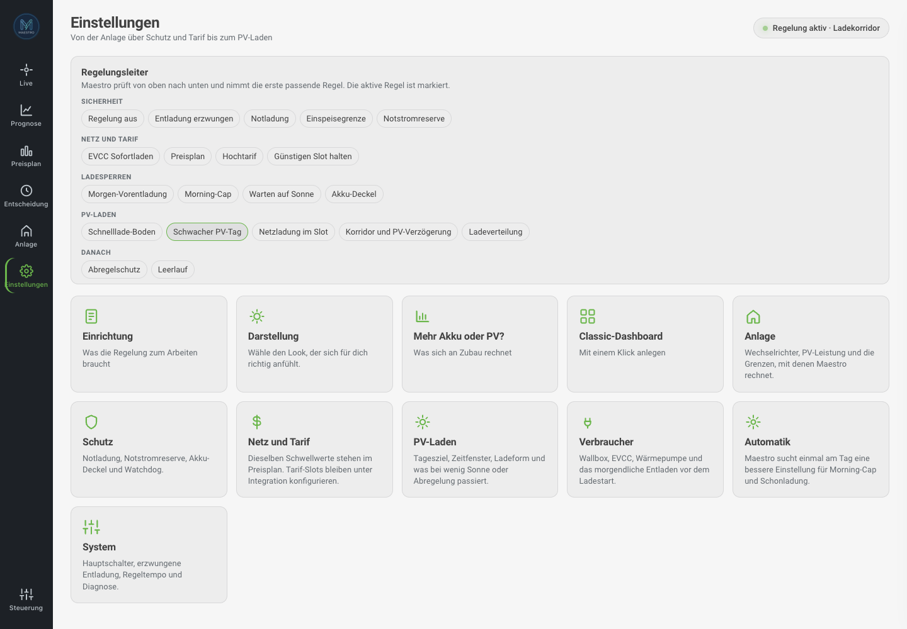
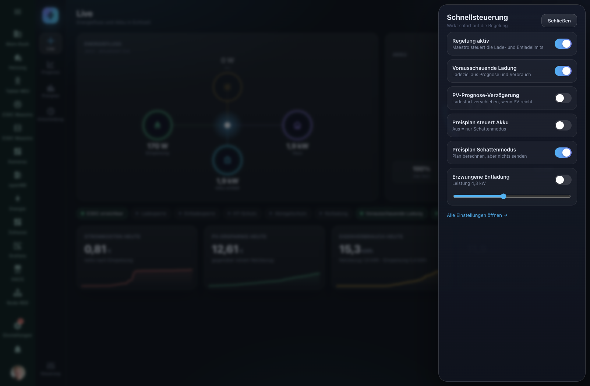
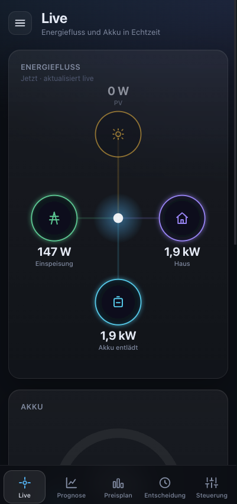

🇬🇧 English | [🇩🇪 Deutsch](README.de.md)

# E3DC Maestro

A Home Assistant custom integration for **intelligent, fully automated charge and discharge control** of E3DC home battery systems.

E3DC Maestro runs entirely **local and without any cloud connection**. It extends the `e3dc_rscp` integration with a rule-based control engine featuring 19 prioritised phases, forward-looking charging, curtailment guard, PV forecast, tariff-aware spreading, wallbox and heat-pump control, and an auto-optimisation mode.

**From 0.5.0 the Maestro Cockpit is enough.** Onboarding, every setting and day-to-day operation live in the sidebar panel. The classic dashboard and the modern dashboard are optional.

[](LICENSE)
[](https://www.paypal.com/paypalme/tommigraf)

---

## Table of Contents

1. [Feature Overview](#feature-overview)
2. [Screenshots](#screenshots)
3. [Requirements](#requirements)
4. [Dependency: configure e3dc_rscp](#dependency-configure-e3dc_rscp)
5. [Installation via HACS](#installation-via-hacs)
6. [Setup (Config Flow)](#setup-config-flow)
7. [Provided Entities](#provided-entities)
   - [Sensors – Standard (enabled)](#sensors--standard-enabled)
   - [Sensors – Diagnostic](#sensors--diagnostic)
   - [How to enable disabled entities](#how-to-enable-disabled-entities)
   - [Binary Sensors](#binary-sensors)
   - [Switches](#switches)
   - [Numbers](#numbers)
   - [Selects](#selects)
   - [Buttons](#buttons)
8. [Rule Logic & Phase Priority](#rule-logic--phase-priority)
9. [Maestro Cockpit](#maestro-cockpit)
10. [Dashboards (optional)](#dashboards-optional)
11. [Sensor Sign Conventions](#sensor-sign-conventions)
12. [Troubleshooting & FAQ](#troubleshooting--faq)
13. [Known Compatibility](#known-compatibility)
14. [Acknowledgements](#acknowledgements)
15. [Changelog](CHANGELOG.md)
16. [License](#license)

---

## Feature Overview

| Feature | Description |
|---|---|
| **Seasonal charge corridor** | Rolling daily target and charge window interpolated between summer and winter |
| **Feed-in limit protection** | Reactively raises charge power when grid export exceeds the 70 % limit |
| **Curtailment guard** | Preventive minimum charge power when inverter clipping is imminent |
| **Emergency reserve** | Seasonally interpolated or consumption-adaptive battery reserve |
| **Peak-tariff (HT) protection** | During high-tariff hours the battery covers the house down to a reserve floor, then discharge is blocked to keep capacity for the rest of the window |
| **PV forecast delay** | Delays corridor charging when Solcast/Forecast.Solar predicts enough PV |
| **Forward-looking charging** | Raises today's charge target when tomorrow's PV is expected to be low |
| **Spreading (charge distribution)** | Spreads PV surplus evenly across the remaining charge window – **default ON since v0.3.1** (hardware protection against 0/max-power bursts) |
| **Morning pre-discharge** | Discharges the battery in the morning to free up capacity for daytime PV |
| **Astro mode** | Dynamically links charge end / charge start to sunset / sunrise |
| **Morning cap** | SoC ceiling in the morning so the battery doesn't fill up too early |
| **Hard SoC limit** | Fixed charge ceiling for battery health (independent of all other phases) |
| **Fast-charge floor** | Charges with full PV surplus until a configurable SoC floor (`fast_floor`) |
| **Low-yield day (battery priority)** | On weak PV days, fills the battery before spreading / corridor pause; gated by remaining forecast vs. remaining need |
| **Auto-optimisation** | Grid-search optimiser automatically selects the best daily strategy |
| **24 h forecast simulation** | Predicted SoC trajectory plus live PV / house / grid / battery chart (last 24 h + next 24 h) |
| **Dynamic tariffs** | Grid charging at low spot prices (Tibber, aWATTar) |
| **Tariff slots** | Fixed time windows with custom charge/discharge rules |
| **Wallbox control** | Current limiting for third-party wallboxes via EVCC/generic; optional discharge guard so EV load is covered from the battery instead of the grid |
| **Heat-pump control** | On/off based on PV surplus with minimum run and pause times |
| **Forced discharge** | Dashboard switch for manual discharge, e.g. before a Tibber low-price window |
| **Maestro Cockpit** | Sidebar panel for onboarding, settings and operation, without custom cards: live energy flow, 24 h forecast, price plan, decision explanation, plant view and quick controls – [guide](#maestro-cockpit) |
| **Control cockpit** | Live command centre with hero status, KPI tiles, active-now chips, 24 h phase history and "Why this decision?" |
| **Decision explanation** | `sensor.e3dc_maestro_entscheidungserklarung` with a full plain-text explanation for every phase |
| **Anti-flapping** | EWMA smoothing of PV/load (τ = 60 s, jump-reset at 2 kW) + feed-in-limit hysteresis + pv-delay cooldown to prevent rapid phase oscillation |
| **Battery & PV Sizing Advisor (v0.3.7)** | 2D simulation (additional battery × additional PV) on historical hourly data — calculates savings, payback time, self-sufficiency and three recommendations (economic / technical / balanced) |
| **Automated tests + CI** | Control engine, forecast/PV parser, optimiser and sizing advisor covered; GitHub Actions runs pytest, Ruff, hassfest and the panel build and tests (Vitest) |

---

## Screenshots

The **Maestro Cockpit** is the interface, from onboarding through daily operation.
Guide: [Maestro Cockpit](#maestro-cockpit). The classic dashboard and the modern
dashboard are optional and not shown here.

### Live



### Forecast



### Price plan



### Decision



### Plant



### Settings



### Controls



### On a phone



---

## Requirements

| Requirement | Details |
|---|---|
| **Home Assistant** | ≥ 2024.1.0 (recommended: ≥ 2024.11) |
| **HACS** | latest version |
| **[e3dc_rscp](https://github.com/torbennehmer/hacs-e3dc)** | must be installed, configured and active |
| **E3DC device** | All E3DC systems supported by `e3dc_rscp` (tested: S10E, S10E Pro) |
| **Solcast / Forecast.Solar** | optional but recommended for PV forecast features (forward-looking charge, PV delay) |

> **Important:** E3DC Maestro reads sensors from `e3dc_rscp` and calls its services (`set_power_limits`, `set_power_mode`, `manual_charge`). Without a working and correctly configured `e3dc_rscp` integration, Maestro **cannot control** the battery.

> **⚠️ AI360 must be disabled:** E3DC's built-in **AI360** function must be disabled in the E3DC device settings. AI360 overrides external charge commands and ignores Maestro's rules — both systems cannot run simultaneously. The setting is in the E3DC web interface or E3DC app under *Settings → Energy Management → AI360*.

---

## Dependency: configure e3dc_rscp

Before setting up E3DC Maestro, `e3dc_rscp` must be **correctly configured**. Incorrect sensor signs are the most common cause of misbehaviour.

### 1. Verify sign conventions

Maestro expects the following sign convention:

| Sensor | Positive | Negative |
|---|---|---|
| `grid_power_sensor` | Export to grid | Import from grid |
| `battery_power_sensor` | Battery charging | Battery discharging |
| `pv_power_sensor` | always ≥ 0 | – |
| `house_power_sensor` | always ≥ 0 | – |

**How to check:** Open *Developer Tools → States* in HA and observe values while PV is producing:
- PV sensor: must be positive (~4000 W at noon)
- Grid sensor: positive when exporting, negative when importing
- Battery sensor: positive while charging, negative while discharging

**If signs are inverted**, create a template sensor (e.g. in `configuration.yaml`):

```yaml
template:
  - sensor:
      - name: "E3DC Grid corrected"
        unit_of_measurement: "W"
        device_class: power
        state_class: measurement
        state: "{{ -(states('sensor.your_grid_sensor') | float(0)) }}"
```

Restart HA after changes.

---

## Installation via HACS

### Step 1: Add repository

1. Open **HACS** → Integrations → three-dot menu (top right) → **Custom repositories**
2. Enter URL: `https://github.com/TommiG1/hacs-e3dc-maestro`
3. Category: **Integration** → **Add**

### Step 2: Download integration

1. Search for **E3DC Maestro** in the HACS integration list
2. Click **Download** → confirm version

From **0.5.0** the cockpit is part of the normal release. You do not need to show beta versions in HACS for it.

### Step 3: Restart Home Assistant

Settings → System → **Restart** (full restart, not just reload)

### Step 4: Set up integration

1. **Settings → Devices & Services → Add Integration**
2. Search for **E3DC Maestro**
3. Follow the setup wizard (see next section)

> **Note:** If E3DC Maestro doesn't appear in the search, clear the browser cache (Ctrl+Shift+R) and try again.

---

## Setup (Config Flow)

The setup wizard has **11 steps**. All parameters can be changed at any time under **Settings → Devices & Services → E3DC Maestro → Configure** — no restart required.

> **Since v0.3.7:** the Configure dialog opens with a **central navigation menu**.
> You can jump directly to any section (sources, system, season, tariff, wallbox,
> heat pump, sizing advisor, …) instead of clicking through all steps in order.
> After editing a section you return to the menu and can either edit another
> section or close the dialog via **Save & Close**.

---

### Step 1: Source entities

Maps Maestro to the sensor entities from `e3dc_rscp` (or Modbus).

> **✨ Auto-detection:** If `e3dc_rscp` is installed, Maestro pre-fills all sensors
> (SoC, PV, house, grid, battery, wallbox consumption) and inverts the grid sign for
> `_transfer_to_from_grid` automatically. An **openWB** wallbox is detected via
> `sensor.openwb_chargepoint*_ladeleistung`, and an existing **EVCC integration**
> ([marq24/ha-evcc](https://github.com/marq24/ha-evcc), domain `evcc_intg`) is detected
> as well. All suggestions can be overridden.

| Field | Required | Typical Entity ID | Convention |
|---|---|---|---|
| **State of Charge (SoC)** | ✓ | `sensor.<devicename>_battery_rsoc` | 0–100 % |
| **PV power** | ✓ | `sensor.<devicename>_solar_power` | W, ≥ 0 |
| **Additional generation** | – | – | W, ≥ 0, added to PV (e.g. second inverter) |
| **House power** | ✓ | `sensor.<devicename>_home_power` | W, ≥ 0 |
| **Grid power** | ✓ | `sensor.<devicename>_grid_power` | W, **positive = export** |
| **Battery power** | ✓ | `sensor.<devicename>_battery_power` | W, **positive = charging, negative = discharging** |
| **Charged today (kWh)** | – | `sensor.<devicename>_battery_charge_today` | kWh (RSCP daily value, more accurate than Riemann sum) |
| **Discharged today (kWh)** | – | `sensor.<devicename>_battery_discharge_today` | kWh (RSCP daily value) |

> **Tip:** `<devicename>` is the name you gave when setting up `e3dc_rscp`. Find exact entity IDs under *Developer Tools → States* — search for `battery_rsoc`, `solar_power`, `grid_power`.

---

### Step 2: System parameters

Describes your system hardware.

| Parameter | Default | Description |
|---|---|---|
| **Inverter rated power (W)** | 12 000 | Maximum AC output power of the inverter |
| **Installed PV capacity (kWp)** | 10.0 | Used for feed-in limit and forecast calculations |
| **Max. charge power (W)** | 3 000 | Upper limit for battery charge commands |
| **Min. charge power (W)** | 300 | Lower limit; below this no charging command is sent |
| **Feed-in limit (%)** | 70 | % of installed kWp — `feed_in_limit` phase triggers above this |
| **Update interval (s)** | 30 | How often Maestro decides; shorter intervals increase DB load |
| **Advanced corridor** | off | If on: charge power directly in W instead of power factor |
| **Lower corridor (W)** | 500 | Minimum charge power in advanced corridor mode |
| **Upper corridor (W)** | 1 500 | Maximum charge power in advanced corridor mode |
| **Charge ramp (W/cycle)** | 500 | Ramp: charge power increases by at most this value per cycle |

---

### Step 3: Season & charge corridor

Defines when and to what SoC target the battery is charged each day.

| Parameter | Default | Description |
|---|---|---|
| **Charge threshold (%)** | 0 | SoC floor for emergency charging (`emergency` phase). 0 turns it off: no grid charging after setup |
| **Charge target SoC (%)** | 85 | Daily target SoC for the seasonal corridor |
| **Winter minimum charge end (h)** | 11:00 | Earliest charge end in winter (local time) |
| **Summer maximum charge end (h)** | 14:00 | Latest charge end in summer (local time) |
| **Summer charge end target (h)** | 18:30 | Battery should be fully charged by this time in summer |

Maestro calculates the optimal charge window **daily** (based on the current date) by interpolating between the summer and winter values.

---

### Step 4: Peak-tariff (HT) protection

During expensive peak-tariff hours the battery keeps covering the house load and is only stopped once it reaches the reserve floor — protecting enough capacity for the rest of the window instead of buying expensive grid power. The `Reserve winter/equinox` values below are that floor (the battery is not discharged **below** them).

| Parameter | Default | Description |
|---|---|---|
| **HT protection enabled** | off | Enables all HT logic |
| **Peak tariff start (h)** | 5 | Local time (CET/CEST automatically) |
| **Peak tariff end (h)** | 21 | Local time |
| **Reserve winter (%)** | 50 | Minimum SoC kept during HT window (winter) |
| **Reserve equinox (%)** | 10 | Minimum SoC at equinox |
| **HT on Saturdays** | off | HT protection also applies on Saturdays |
| **HT on Sundays** | off | HT protection also applies on Sundays |

---

### Step 5: PV forecast / charge delay

Delays the corridor charge start if today's remaining PV forecast is sufficient to fill the battery later.

| Parameter | Default | Description |
|---|---|---|
| **PV forecast delay** | off | Enables `pv_delay` phase |
| **Forecast sensor** | – | Entity ID of a sensor providing remaining PV kWh today |
| **Min. forecast (kWh)** | 5.0 | Absolute threshold: only delay if forecast ≥ this value |
| **Usable battery capacity (kWh)** | 10.0 | How many kWh the battery still needs to reach target SoC |
| **Safety factor** | 1.2 | Forecast must be ≥ required × factor |
| **Tomorrow PV sensor** | – | For forward-looking charging: tomorrow's PV forecast (kWh) |
| **Tomorrow consumption sensor** | – | For forward-looking charging: estimated consumption tomorrow (kWh) |

**Recommended forecast integrations (HACS):**
- [Solcast PV Forecast](https://github.com/BJReplay/ha-solcast-solar): `sensor.solcast_pv_forecast_forecast_today_remaining` / `sensor.solcast_pv_forecast_forecast_tomorrow`
- [Forecast.Solar](https://www.home-assistant.io/integrations/forecast_solar/): `sensor.energy_production_today_remaining`

---

### Step 6: Dynamic tariffs & tariff slots

Charges the battery from the grid when the spot electricity price is cheap.

| Parameter | Default | Description |
|---|---|---|
| **Dynamic tariffs** | off | Enables cheap grid charging |
| **Price sensor (€/kWh)** | – | e.g. Tibber or aWATTar price sensor |
| **Cheap threshold (€/kWh)** | 0.10 | Below this price, grid charging is triggered |
| **Max. grid charge/day (kWh)** | 0 | Safety cap: Maestro stops grid charging after this much in one day. Target and forecast decide the amount. 0 = no cap |
| **Active grid charge in low slot** | off | In a `low` slot, actively charges from the grid up to the target SoC — **regardless of tariff mode** (phase `grid_charge`). For classic off-peak (NT) windows |
| **Grid charge target in low slot (% SoC)** | 60 | Target SoC charged from the grid inside a `low` slot. At most the hard SoC limit. Acts as upper bound when forecast-based |
| **Forecast-based grid charge amount** | off | Instead of a fixed target SoC, charges only what the battery needs from the end of the window until the next cheap window (consumption profile × safety factor − PV forecast, plus reserve). Falls back to the fixed target without consumption profiles |

> **Passive vs. active `low` slot:** Without this option the `low` class is
> purely passive — it only lifts the PV-surplus ceiling, and only when
> `tariff_mode=dynamic`. For a classic peak/off-peak contract (fixed tariff),
> enable **Active grid charge in low slot** so the off-peak window is actually
> used to recharge.

### Price plan (beta)

Uses the price curve (today + tomorrow), the PV forecast and your consumption
profile to work out when **grid charging** and **holding discharge** pay off. The
plan is visible as a sensor (`sensor.e3dc_maestro_preisplan`). The second switch,
**Price plan controls the battery**, makes Maestro actually execute it – without
it the plan stays display-only (shadow mode). It is calculated as long as
**Price plan (shadow mode)** is switched on.

**Setup** (Settings → Devices & services → E3DC Maestro → Configure):

1. **Tariff & costs:** pick the price sensor (attributes `raw_today`/`raw_tomorrow`,
   e.g. Nordpool, EPEX, aWATTar; the Tibber electricity-price sensor is enough, Maestro fetches the curve itself), feed-in tariff, battery
   purchase cost and lifetime (cycles), max grid charge/day.
2. **System parameters:** battery capacity, max charge power, inverter power.
3. **PV forecast:** enable a forecast sensor (Solcast / Forecast.Solar) – without
   one the plan falls back conservatively to history.
4. **Season & charge corridor:** charge threshold and emergency reserve (floor of the plan).
5. Enable **Calculate price plan** (switch **Price plan (shadow mode)**; “on” means: the plan is calculated but not yet executed) – also available in the dashboard.
   Review the recommendations for a day or two (tab **Grid & Tariff**).
6. Enable **Price plan controls the battery**: Maestro then charges from the grid in
   cheap slots (phase `grid_charge`, reason "Preisplan: …") and blocks discharge when
   saving energy for pricier slots pays off (phase `grid_hold`). Emergency charge,
   feed-in limit, EVCC pause and curtailment guard take priority. If the price
   sensor drops out (plan older than 20 min) Maestro falls back to normal control.

Fine-tuning in the dashboard (tab **Grid & Tariff**): max target SoC (90 %),
minimum price spread (0.03 €/kWh), efficiency (0.90), consumption safety factor
(1.15). Full guide: **“Help for the price plan”** button in the dashboard.

---

### Step 7: Wallbox

Controls wallbox charge current based on PV surplus **and/or** cleanly separates the
wallbox consumption from the house load.

#### House / wallbox load split (since v0.3.1)

If you configure a **wallbox power sensor**, Maestro separates the EV charge load from
the house load. EWMA smoothing, PV forecast and the optimizer are then **no longer
distorted by EV charge spikes**. The split is independent of the “Wallbox control”
switch — you can wire up the sensor purely for clean statistics.

| Parameter | Default | Description |
|---|---|---|
| **Wallbox control** | off | Enables current-limiting logic |
| **Wallbox type** | e3dc | `e3dc` = native E3DC wallbox (RSCP service); `generic` = openWB / EVCC / any wallbox via custom services |
| **Wallbox power sensor** | – | Wattage sensor of the wallbox (e.g. `sensor.<device>_wallbox_consumption` or `sensor.openwb_chargepoint_4_ladeleistung`). Auto-detected. |
| **House meter already includes wallbox** | auto | `false` for native E3DC wallbox (separate power meter); `true` for openWB on the grid meter. If on, Maestro subtracts the wallbox value from the house power. |
| **Min. current (A)** | 6 | IEC-61851 minimum |
| **Max. current (A)** | 16 | Maximum allowed charge current |
| **Phases** | 3 | 1 or 3 phases |
| **Min. PV surplus (W)** | 1 400 | Wallbox activates only above this surplus |

**New sensors:** `sensor.e3dc_maestro_wallbox_leistung` (W), `sensor.e3dc_maestro_gesamtlast_haus_wallbox` (W = house + wallbox), `sensor.e3dc_maestro_wallbox_energie_heute` (kWh, Energy-Dashboard compatible).

---

### Step 7b: EVCC integration (OpenWB, evcc.io)

Maestro can monitor an EVCC-compatible wallbox and react accordingly.

| Parameter | Default | Description |
|---|---|---|
| **EVCC integration** | off | |
| **EVCC charging sensor** | – | Sensor or binary sensor showing whether the car is actively charging |
| **EVCC mode sensor** | – | Sensor reporting the active charging mode |
| **Now-mode value** | `now` | Which mode-sensor value counts as "instant charge" (evcc.io: `now`; OpenWB: `Instant Charging`) |
| **Discharge limit in Now mode** | `0` W | Max battery discharge power while EVCC charges in Now mode. `0` = fully block discharge. |

---

### Step 8: Heat pump

Switches the heat pump on when PV surplus is available.

| Parameter | Default | Description |
|---|---|---|
| **HP control** | off | |
| **HP switch entity** | – | `switch.xxx` or `input_boolean.xxx` |
| **Min. PV surplus (W)** | 2 000 | Switch-on threshold |
| **Max. electricity price (€/kWh)** | 0.15 | No switch-on above this price |
| **HP min. run time (min)** | 20 | HP stays on for at least this long |
| **HP min. pause time (min)** | 15 | HP stays off for at least this long |

---

### Step 9: Failsafe & watchdog

| Parameter | Default | Description |
|---|---|---|
| **Watchdog timeout (min)** | 10 | After this many minutes with sensor errors, Maestro sends a persistent HA notification. `0` = disabled. |

---

### Step 10: F0 / Gentle-Charge & F3 Auto-Mode

Fine-tuning of the gentle-charge ramp and the auto-optimiser objective. Defaults
are sensible — advanced tuning only.

---

### Step 11: Battery & PV Sizing Advisor (v0.3.7)

The Sizing Advisor runs a **2D historical simulation** (additional battery
× additional PV) on hourly energy data from the **HA Energy Dashboard** (Recorder
long-term statistics, `statistics_during_period`). It calculates savings, payback
time, self-sufficiency and three recommendations.

> **✨ Auto-detection:** all energy sensors (PV, house, grid import/export,
> battery charge/discharge, optional wallbox + heat pump) are pre-filled from the
> HA Energy Dashboard. The PV slot accepts **multiple sensors** (multi-inverter
> setups). RSCP sensors are used as fallback.

| Parameter | Default | Range | Description |
|---|---:|:---:|---|
| Analysis period | 365 days | 30–730 | How many days of history to analyse |
| Electricity price | 0.30 €/kWh | 0.05–2.00 | For savings calculation |
| Feed-in tariff | 0.08 €/kWh | 0.00–1.00 | FiT revenue for avoided grid export |
| Battery price | 600 €/kWh | 100–5 000 | Battery investment cost |
| PV price | 1 200 €/kWp | 200–5 000 | PV expansion investment cost |
| Inverter upgrade flat | 1 500 € | 0–20 000 | One-off cost for inverter replacement |
| Round-trip efficiency | 92 % | 50–100 % | Battery charge/discharge round-trip |
| Max. battery sweep | 30 kWh | 5–200 | Upper bound for battery sweep |
| Battery step size | 2.5 kWh | 0.5–10 | Resolution along the battery axis |
| Max. PV sweep | 20 kWp | 0–200 | Upper bound for PV sweep |
| PV step size | 2.0 kWp | 0.5–10 | Resolution along the PV axis |

The analysis is started via **Sizing Advisor → Start analysis** in the dashboard
(button entity `button.e3dc_maestro_sizing_analyse_starten`). It runs in a thread
pool (does not block the HA event loop). The result is persisted via `Store` and
survives HA restarts.

> **Scenario sliders:** the scenario explorer (sliders for additional battery /
> PV) interpolates bilinearly inside the sweep matrix, so live updates are
> CPU-free. The cost inputs (battery price, PV price, inverter upgrade, extra)
> recalculate investment and payback **instantly** without re-running the
> simulation.

### Finish: Add the dashboard

After the Sizing Advisor, the setup flow shows an **“Add dashboard”** page.
When you finish, Home Assistant also creates a persistent notification with
the same instructions:

1. **Hard-reload** the browser (Cmd/Ctrl+Shift+R)
2. **Settings → Dashboards → Add dashboard**
3. Under **Community dashboards**, choose **E3DC Maestro**
4. Keep the suggested title **E3DC Maestro** → Create

Requirements: **Home Assistant ≥ 2026.5**, plus Mushroom Cards and ApexCharts
Card from HACS. The URL path must be `e3dc-maestro` so help links work. Older
HA versions can use the manual YAML import as a fallback.

---

## Provided Entities

All entities appear under the device **E3DC Maestro** in *Settings → Devices & Services → E3DC Maestro → Show device*.

---

### Sensors – Standard (enabled)

| Entity ID | Name | Unit | Description |
|---|---|---|---|
| `sensor.e3dc_maestro_regelphase` | Control phase | – | Current active phase (enum, see rule logic) |
| `sensor.e3dc_maestro_ziel_ladeleistung` | Target charge power | W | Calculated target charge power (0 when inactive) |
| `sensor.e3dc_maestro_ziel_soc` | Target SoC | % | Current daily charge target |
| `sensor.e3dc_maestro_letzte_aktion` | Last action | – | Phase + reason + parameters of the last control action (as attributes) |
| `sensor.e3dc_maestro_entscheidungserklarung` | Decision explanation | – | Plain-language “why this decision?” for the current phase |
| `sensor.e3dc_maestro_geladen_heute` | Charged today | kWh | Energy charged today |
| `sensor.e3dc_maestro_entladen_heute` | Discharged today | kWh | Energy discharged today |
| `sensor.e3dc_maestro_einspeise_eingriffe_heute` | Feed-in interventions today | – | Number of interventions due to feed-in limit |
| `sensor.e3dc_maestro_pv_verlust_verhindert_heute` | PV loss prevented today | kWh | Sum of prevented curtailment + feed-in limit interventions |
| `sensor.e3dc_maestro_autonomiezeit` | Autonomy time | – | Estimated battery range as "Xh YYmin" |
| `sensor.e3dc_maestro_vorausschauendes_ladeziel` | Forward-looking charge target | % | Dynamic charge target based on tomorrow's PV forecast |
| `sensor.e3dc_maestro_morgen_pv_prognose` | Tomorrow PV forecast | kWh | Solcast forecast for tomorrow |
| `sensor.e3dc_maestro_morgen_energiedefizit` | Tomorrow energy deficit | kWh | max(0, consumption − PV) tomorrow |
| `sensor.e3dc_maestro_saisonales_ladeende_uhrzeit` | Seasonal charge end | – | Calculated charge end target today (HH:MM) |
| `sensor.e3dc_maestro_astro_ladestart_uhrzeit` | Astro charge start | – | Calculated charge start after sunrise (HH:MM) |
| `sensor.e3dc_maestro_forecast_min_soc_nachste_24h` | Forecast: Min SoC next 24h | % | Simulated minimum SoC in the next 24 h |
| `sensor.e3dc_maestro_forecast_max_soc_nachste_24h` | Forecast: Max SoC next 24h | % | Simulated maximum SoC |
| `sensor.e3dc_maestro_forecast_netzbezug_nachste_24h` | Forecast: Grid draw next 24h | kWh | Simulated grid import |
| `sensor.e3dc_maestro_forecast_autarkie_nachste_24h` | Forecast: Self-sufficiency next 24h | % | Simulated self-sufficiency rate |
| `sensor.e3dc_maestro_forecast_soc_trajektorie_24h` | Forecast: SoC trajectory 24h | % | ApexCharts sensor with SoC and power points (`trajectory_points`, `pv_points`, `house_points`, `grid_points`, `battery_points`) |
| `sensor.e3dc_maestro_forecast_datenqualitat` | Forecast: Data quality | – | Shows whether consumption and PV profiles have sufficient data |
| `sensor.e3dc_maestro_auto_aktive_strategie` | Auto: Active strategy | – | Shows whether auto-optimisation is active and which objective was chosen |
| `sensor.e3dc_maestro_auto_geschatzte_einsparung` | Auto: Estimated savings | % | Simulated improvement vs. baseline |
| `sensor.e3dc_maestro_soll_lade_limit` | Target charge limit | W | Currently set charge limit (e.g. 0 W when blocked, 3000 W during curtailment guard); `unknown` if no limit active |
| `sensor.e3dc_maestro_soll_entlade_limit` | Target discharge limit | W | Currently set discharge limit (e.g. 0 W during EVCC pause); `unknown` if no limit active |
| `sensor.e3dc_maestro_preisplan` | Price plan | – | Summary of the price plan (beta); slots, shadow mode and expected saving as attributes |
| `sensor.e3dc_maestro_wallbox_leistung` | Wallbox power | W | Current wallbox charging power (see step 7) |
| `sensor.e3dc_maestro_gesamtlast_haus_wallbox` | Total load (house + wallbox) | W | House power plus wallbox power |
| `sensor.e3dc_maestro_wallbox_energie_heute` | Wallbox energy today | kWh | Energy charged into the wallbox today (usable in the Energy dashboard) |
| `sensor.e3dc_maestro_pv_power` | PV power | W | Stable mirror of the PV measurement, independent of the source entity (sign: [Sensor Sign Conventions](#sensor-sign-conventions)); used by dashboards and the cockpit |
| `sensor.e3dc_maestro_house_power` | House power | W | Stable mirror of house consumption (always ≥ 0) |
| `sensor.e3dc_maestro_grid_power` | Grid power | W | Stable mirror of grid power (positive = feed-in, negative = import) |
| `sensor.e3dc_maestro_battery_power` | Battery power | W | Stable mirror of battery power (positive = charging, negative = discharging) |
| `sensor.e3dc_maestro_netzbezug_heute` | Grid import today | kWh | Energy imported from the grid today |
| `sensor.e3dc_maestro_netzeinspeisung_heute` | Grid feed-in today | kWh | Energy fed into the grid today |
| `sensor.e3dc_maestro_stromkosten_heute` | Electricity cost today | EUR | Cost of grid import today |
| `sensor.e3dc_maestro_einspeise_erlos_heute` | Feed-in revenue today | EUR | Feed-in remuneration today |
| `sensor.e3dc_maestro_netto_stromkosten_heute` | Net electricity cost today | EUR | Import cost minus feed-in revenue |
| `sensor.e3dc_maestro_pv_eigenverbrauch_heute` | PV self-consumption today | kWh | Self-consumed PV energy today |
| `sensor.e3dc_maestro_pv_ersparnis_heute` | PV savings today | EUR | Savings compared with buying everything from the grid |
| `sensor.e3dc_maestro_akku_verschleiss_heute` | Battery wear today | EUR | Share of battery cost for today's cycles (from purchase cost and lifetime) |
| `sensor.e3dc_maestro_energiebilanz_heute` | Energy balance today | EUR | Feed-in revenue + PV savings − electricity cost − battery wear |
| `sensor.e3dc_maestro_netz_akku_heute` | Grid → battery today | kWh | Energy charged from the grid into the battery today (basis for *Grid charge without justification*) |
| `sensor.e3dc_maestro_pv_tagesprognose` | PV day forecast | kWh | PV yield forecast for today (basis of low-yield-day detection) |
| `sensor.e3dc_maestro_pv_restprognose_p10` | PV remaining forecast (P10) | kWh | Conservative remaining PV forecast for today (P10), e.g. for dynamic spreading |

#### Sizing Advisor sensors (v0.3.7)

Static analysis results (filled after pressing **Start analysis**):

| Entity ID | Name | Unit | Description |
|---|---|---|---|
| `sensor.e3dc_maestro_advisor_status` | Advisor status | – | `idle` / `running` / `ready` |
| `sensor.e3dc_maestro_advisor_netzbezug_baseline_jahr` | Baseline grid import | kWh | Historic actual grid import (baseline scenario) |
| `sensor.e3dc_maestro_advisor_wirtschaftl_empfehlung_amortisation` | Recommendation – economic | – | Combination with min. payback time (attributes: full breakdown) |
| `sensor.e3dc_maestro_advisor_techn_empfehlung_autarkie` | Recommendation – technical | – | Combination with max. self-sufficiency |
| `sensor.e3dc_maestro_advisor_energiebilanz_anomalierate` | Anomaly rate | % | Share of hours with energy-balance anomalies (>5 % house load) |

Scenario sensors (live, follow the two sliders):

| Entity ID | Name | Unit | Description |
|---|---|---|---|
| `sensor.e3dc_maestro_advisor_autarkie_szenario` | Scenario self-sufficiency | % | For the current slider values |
| `sensor.e3dc_maestro_advisor_vermiedener_netzbezug_jahr` | Avoided grid import (scenario) | kWh | Per year |
| `sensor.e3dc_maestro_advisor_ersparnis_jahr` | Annual savings (scenario) | EUR | Per year |
| `sensor.e3dc_maestro_advisor_investition` | Investment (scenario) | EUR | Live from price entities |
| `sensor.e3dc_maestro_advisor_amortisationszeit` | Payback time (scenario) | years | Live from price entities |
| `sensor.e3dc_maestro_advisor_zyklen_jahr_virt_akku` | Cycles per year (scenario) | – | Battery wear indicator |
| `sensor.e3dc_maestro_advisor_sizing_matrix` | Sizing matrix | – | Result of the 2D simulation (full matrix and recommendations as attributes; only updated after “Start analysis”) |
| `sensor.e3dc_maestro_advisor_szenario` | Scenario | EUR | Key figures of the current slider scenario as attributes |

---

### Sensors – Diagnostic

Diagnostic sensors are grouped under the **Diagnostic** category in the entity list. All sensors are **enabled** after installation. The `debug_log` sensor is only useful with debug logging switched on.

| Entity ID | Name | Description |
|---|---|---|
| `sensor.e3dc_maestro_abregelung_verhindert_heute` | Curtailment prevented today | Energy secured by feed-in limit intervention (detail value of `pv_verlust_verhindert`) |
| `sensor.e3dc_maestro_dc_abregelung_verhindert_heute` | DC curtailment prevented today | Energy secured by curtailment guard (detail value) |
| `sensor.e3dc_maestro_notstromreserve_aktuell` | Emergency reserve (current) | Currently calculated reserve SoC (seasonally interpolated) |
| `sensor.e3dc_maestro_notstromreserve_adaptiv` | Emergency reserve (adaptive) | Consumption-adaptive calculated reserve |
| `sensor.e3dc_maestro_ht_reserve_adaptiv` | HT reserve (adaptive) | Adaptively calculated HT reserve |
| `sensor.e3dc_maestro_gesendetes_lade_limit` | Sent charge limit | Charge limit actually sent to the E3DC, in W (counterpart of *Target charge limit*) |
| `sensor.e3dc_maestro_gesendetes_entlade_limit` | Sent discharge limit | Discharge limit actually sent to the E3DC, in W |
| `sensor.e3dc_maestro_pv_referenz_ertrag` | PV reference yield | Reference daily yield (kWh) for low-yield-day detection |
| `sensor.e3dc_maestro_pv_tag_quote` | PV day ratio | Ratio of day forecast to reference yield |
| `sensor.e3dc_maestro_ladestart_morgen_prognose` | Charge start tomorrow (forecast) | Expected charge start tomorrow (HH:MM, astro mode only) |
| `sensor.e3dc_maestro_ladeende_morgen_prognose` | Charge end tomorrow (forecast) | Expected charge end tomorrow (HH:MM) |
| `sensor.e3dc_maestro_verzogerter_ladestart_heute` | Delayed charge start today | Expected charge start while PV delay is active (HH:MM, otherwise `unknown`) |
| `sensor.e3dc_maestro_debug_log` | Debug log | Last 5 rule log entries; only useful with debug logging enabled |

---

### How to enable disabled entities

If you disabled entities yourself (or an older version created them disabled):

1. **Settings → Devices & Services → E3DC Maestro → Show device**
2. Scroll to the entity list, click **"Show disabled entities"** (link at the bottom)
3. Click the desired entity
4. In the dialog: **"Enable entity"** → Confirm
5. The entity will show values after the next update cycle (~30 s)

Alternatively via *Settings → Entities*: filter by "E3DC Maestro" + tick "Show only disabled".

---

### Binary Sensors

| Entity ID | Name | Meaning |
|---|---|---|
| `binary_sensor.e3dc_maestro_e3dc_erreichbar` | E3DC reachable | E3DC responds to RSCP requests |
| `binary_sensor.e3dc_maestro_einspeisedrosselung_aktiv` | Feed-in throttling active | `feed_in_limit` phase active |
| `binary_sensor.e3dc_maestro_ht_schutz_aktiv` | HT protection active | `ht_protection` phase active |
| `binary_sensor.e3dc_maestro_notfallladung_aktiv` | Emergency charging active | `emergency` phase active |
| `binary_sensor.e3dc_maestro_abregelschutz_aktiv` | Curtailment guard active | `curtailment_guard` phase active |
| `binary_sensor.e3dc_maestro_netzladung_aktiv` | Grid charge active | `grid_charge` phase active |
| `binary_sensor.e3dc_maestro_schwacher_pv_tag` | Low-yield day | Today classified as a weak PV day (all-day flag) |
| `binary_sensor.e3dc_maestro_akku_prioritat_aktiv` | Battery priority active | Remaining-need gate is currently forcing battery-first charging |
| `binary_sensor.e3dc_maestro_netzladung_ohne_rechtfertigung` | Grid charge without justification | `on` with a fixed tariff when more than 0.5 kWh were charged from the grid into the battery today (plausibility check, problem sensor) |
| `binary_sensor.e3dc_maestro_ladesperre_aktiv` | Charge block active | `on` when Maestro has set a charge limit ≤ 0 W |
| `binary_sensor.e3dc_maestro_entladesperre_aktiv` | Discharge block active | `on` when Maestro has set a discharge limit ≤ 0 W (e.g. during EVCC pause) |
| `binary_sensor.e3dc_maestro_advisor_wr_upgrade_empfohlen` | Inverter upgrade recommended (Advisor) | `on` when the current slider scenario **or** the economic recommendation requires an inverter upgrade |

---

### Switches

| Entity ID | Name | Description |
|---|---|---|
| `switch.e3dc_maestro_regelung_aktiv` | Control active | **Master switch** — disables all control interventions |
| `switch.e3dc_maestro_erzwungene_entladung` | Forced discharge | Forces battery discharge, e.g. to free up capacity before a Tibber low-price window |
| `switch.e3dc_maestro_ht_nt_schutz` | HT/NT protection | Peak-tariff protection on/off |
| `switch.e3dc_maestro_ht_samstag` | HT Saturday | HT protection also on Saturdays |
| `switch.e3dc_maestro_ht_sonntag` | HT Sunday | HT protection also on Sundays |
| `switch.e3dc_maestro_wallbox_regelung` | Wallbox control | Wallbox control on/off |
| `switch.e3dc_maestro_wallbox_entladeschutz` | Wallbox discharge guard | Keep battery discharge open while the EV is charging |
| `switch.e3dc_maestro_warmepumpen_regelung` | Heat pump control | HP control on/off |
| `switch.e3dc_maestro_debug_logging` | Debug logging | Enables verbose log entries in the debug sensor |
| `switch.e3dc_maestro_saisonale_notstromreserve` | Seasonal emergency reserve | Seasonally interpolated reserve on/off |
| `switch.e3dc_maestro_adaptive_reserve_verbrauchsmittel` | Adaptive reserve | Consumption-adaptive reserve on/off |
| `switch.e3dc_maestro_evcc_integration` | EVCC integration | Enables EVCC/OpenWB coupling |
| `switch.e3dc_maestro_abregelschutz` | Curtailment guard | Curtailment guard on/off |
| `switch.e3dc_maestro_korridor_pause_min_ladeleistung` | Corridor pause | Pauses charging when power would fall below the minimum |
| `switch.e3dc_maestro_spat_ladung_two_tier` | Late charging (two-tier) | Second charge target in the evening |
| `switch.e3dc_maestro_vorentladung_tibber_auto` | Pre-discharge Tibber auto | Automatic pre-discharge based on Tibber price |
| `switch.e3dc_maestro_ladeverteilung_spreading` | Charge spreading | Spread PV surplus evenly (default ON since v0.3.1) |
| `switch.e3dc_maestro_astro_modus_sonnenuberwachung` | Astro mode | Link charge end/start to sun position |
| `switch.e3dc_maestro_morning_cap_soc_deckel_morgens` | Morning cap | Morning SoC ceiling active |
| `switch.e3dc_maestro_schonladung_reduzierte_ladeleistung` | Gentle charging | Reduced charge power for battery health |
| `switch.e3dc_maestro_auto_optimierung` | Auto-optimisation | Grid-search optimiser on/off |
| `switch.e3dc_maestro_hard_soc_limit_akku_deckel` | Hard SoC limit | Fixed charge ceiling on/off |
| `switch.e3dc_maestro_vorausschauende_ladung` | Forward-looking charging | Raises today's charge target if tomorrow's PV is expected to be low |
| `switch.e3dc_maestro_schwacher_pv_tag_prioritat` | Low-yield-day priority | Battery-first charging on weak PV days |
| `switch.e3dc_maestro_schnelllade_boden` | Fast-charge floor | Full PV surplus until the floor SoC |
| `switch.e3dc_maestro_dynamische_tarife` | Dynamic tariffs | Enables cheap grid charging (see step 6) |
| `switch.e3dc_maestro_aktive_netzladung_im_low_slot` | Active grid charge in low slot | Actively charges from the grid in the `low` slot up to the target SoC |
| `switch.e3dc_maestro_netzlade_menge_prognosebasiert` | Grid-charge amount forecast-based | Grid-charge amount from tomorrow's PV/consumption forecast instead of a fixed target SoC |
| `switch.e3dc_maestro_entladung_im_low_slot_nach_ziel_sperren` | Block discharge in low slot after target | Blocks discharge once the grid-charge target is reached (phase `grid_hold`) |
| `switch.e3dc_maestro_pv_prognose_verzogerung` | PV forecast delay | Postpones the charge start when the PV forecast is enough for charging |
| `switch.e3dc_maestro_erweiterter_ladekorridor` | Advanced charge corridor | Extended power-factor calculation of the charge corridor |
| `switch.e3dc_maestro_preisplan_schattenmodus` | Price plan (shadow mode) | **On = plan is calculated** and shown as a sensor/in the dashboard but not yet executed (shadow mode). This is the “Calculate price plan” switch |
| `switch.e3dc_maestro_preisplan_steuert_akku` | Price plan controls the battery | Actually executes the calculated price plan (grid charge in cheap slots, hold discharge). Off = shadow mode only |

---

### Numbers

All Config Flow parameters are also available as Number entities and can be **changed live** (immediately persisted, no restart required).

| Entity ID | Name | Unit |
|---|---|---|
| `number.e3dc_maestro_wr_leistung` | Inverter power | W |
| `number.e3dc_maestro_max_ladeleistung` | Max. charge power | W |
| `number.e3dc_maestro_min_ladeleistung` | Min. charge power | W |
| `number.e3dc_maestro_installierte_pv_leistung` | Installed PV capacity | kWp |
| `number.e3dc_maestro_einspeisegrenze` | Feed-in limit | % |
| `number.e3dc_maestro_ladeschwelle` | Charge threshold | % |
| `number.e3dc_maestro_ladeende_soc` | Charge target SoC | % |
| `number.e3dc_maestro_ladeende_winter` | Charge end winter | h |
| `number.e3dc_maestro_ladeende_sommer` | Charge end summer | h |
| `number.e3dc_maestro_sommerladeende_ziel` | Summer charge end target | h |
| `number.e3dc_maestro_spreading_ziel_soc` | Spreading target SoC | % |
| `number.e3dc_maestro_unterer_ladekorridor` | Lower charge corridor | W |
| `number.e3dc_maestro_oberer_ladekorridor` | Upper charge corridor | W |
| `number.e3dc_maestro_ht_beginn` | HT start | h |
| `number.e3dc_maestro_ht_ende` | HT end | h |
| `number.e3dc_maestro_ht_reserve_winter` | HT reserve winter | % |
| `number.e3dc_maestro_ht_sockel_aquinoktium` | HT reserve equinox | % |
| `number.e3dc_maestro_gunstig_schwelle` | Cheap threshold | €/kWh |
| `number.e3dc_maestro_max_netzladung_tag` | Max. grid charge/day | kWh |
| `number.e3dc_maestro_wallbox_min_strom` | Wallbox min. current | A |
| `number.e3dc_maestro_wallbox_max_strom` | Wallbox max. current | A |
| `number.e3dc_maestro_wallbox_mindest_uberschuss` | Wallbox min. surplus | W |
| `number.e3dc_maestro_wp_mindest_uberschuss` | HP min. surplus | W |
| `number.e3dc_maestro_wp_max_preis` | HP max. price | €/kWh |
| `number.e3dc_maestro_wp_mindestlaufzeit` | HP min. run time | min |
| `number.e3dc_maestro_wp_mindestpause` | HP min. pause time | min |
| `number.e3dc_maestro_watchdog_timeout` | Watchdog timeout | min |
| `number.e3dc_maestro_ladeleistungs_anlauf` | Charge ramp | W/cycle |
| `number.e3dc_maestro_notstromreserve_winter` | Emergency reserve winter | % |
| `number.e3dc_maestro_notstromreserve_aquinoktium` | Emergency reserve equinox | % |
| `number.e3dc_maestro_abregelschutz_einschaltschwelle` | Curtailment guard activation threshold | W |
| `number.e3dc_maestro_abregelschutz_ausschaltschwelle` | Curtailment guard release threshold | W |
| `number.e3dc_maestro_spatziel_soc` | Late target SoC | % |
| `number.e3dc_maestro_spat_ladeende_stunde` | Late charge end hour | h |
| `number.e3dc_maestro_vorentladungs_ziel_soc` | Pre-discharge target SoC | % |
| `number.e3dc_maestro_vorentladungs_einschwelle_soc` | Pre-discharge activation SoC | % |
| `number.e3dc_maestro_vorentladungs_offset_stunden_vor_ladestart` | Pre-discharge offset | h |
| `number.e3dc_maestro_vorentladungs_max_leistung` | Pre-discharge max. power | W |
| `number.e3dc_maestro_erzwungene_entladungsleistung` | Forced discharge power | W |
| `number.e3dc_maestro_tibber_schwelle_fur_netzexport` | Tibber threshold for grid export | €/kWh |
| `number.e3dc_maestro_ladeende_offset_zu_sonnenuntergang` | Charge end offset to sunset | h |
| `number.e3dc_maestro_ladestart_offset_nach_sonnenaufgang` | Charge start offset after sunrise | h |
| `number.e3dc_maestro_morning_cap_soc_grenze` | Morning cap SoC ceiling | % |
| `number.e3dc_maestro_morning_cap_aktiv_bis_uhr_lokal` | Morning cap active until (hour) | h |
| `number.e3dc_maestro_schonladung_faktor` | Gentle charge factor | – |
| `number.e3dc_maestro_hard_soc_limit_akku_deckel` | Hard SoC limit | % |
| `number.e3dc_maestro_vorausschauende_ladung_max_soc` | Forward-looking charge max SoC | % |
| `number.e3dc_maestro_aktualisierungsintervall` | Update interval | s |
| `number.e3dc_maestro_soc_hysterese` | SoC hysteresis | % |
| `number.e3dc_maestro_schnelllade_boden_soc` | Fast-charge floor SoC | % |
| `number.e3dc_maestro_mindest_soc_vor_verzogerung` | Minimum SoC before delay | % |
| `number.e3dc_maestro_pv_forecast_schwelle` | PV forecast threshold | kWh |
| `number.e3dc_maestro_pv_forecast_sicherheitsfaktor` | PV forecast safety factor | – |
| `number.e3dc_maestro_schwacher_pv_tag_schwelle` | Low-yield-day threshold | – |
| `number.e3dc_maestro_pv_referenz_manuell_0_automatisch` | PV reference manual (0 = automatic) | kWh |
| `number.e3dc_maestro_pv_referenz_faktor_kwh_kwp` | PV reference factor | kWh/kWp |
| `number.e3dc_maestro_wallbox_entladeschutz_schwelle` | Wallbox grid-guard threshold | W |
| `number.e3dc_maestro_evcc_now_modus_entladungslimit` | EVCC now-mode discharge limit | W |
| `number.e3dc_maestro_strompreis_bezug_fest` | Electricity price import (fixed) | €/kWh |
| `number.e3dc_maestro_einspeisevergutung` | Feed-in tariff | €/kWh |
| `number.e3dc_maestro_netzlade_ziel_im_low_slot` | Grid-charge target in low slot | % |
| `number.e3dc_maestro_akku_anschaffungskosten` | Battery purchase cost | € |
| `number.e3dc_maestro_akku_lebensdauer_zyklen` | Battery lifetime (cycles) | cycles |
| `number.e3dc_maestro_preisplan_ziel_soc_obergrenze` | Price plan target SoC cap | % |
| `number.e3dc_maestro_preisplan_mindest_preisspanne` | Price plan minimum price spread | €/kWh |
| `number.e3dc_maestro_preisplan_wirkungsgrad` | Price plan efficiency | – |
| `number.e3dc_maestro_preisplan_verbrauchs_sicherheitsfaktor` | Price plan consumption safety factor | – |

#### Sizing Advisor numbers (v0.3.7)

| Entity ID | Name | Unit |
|---|---|---|
| `number.e3dc_maestro_advisor_hypothetische_batteriekapazitat` | Hypothetical additional battery | kWh |
| `number.e3dc_maestro_advisor_hypothetische_pv_erweiterung` | Hypothetical additional PV | kWp |
| `number.e3dc_maestro_advisor_preis_akku_eur_kwh` | Battery price | €/kWh |
| `number.e3dc_maestro_advisor_preis_pv_eur_kwp` | PV price | €/kWp |
| `number.e3dc_maestro_advisor_preis_wr_upgrade_eur` | Inverter upgrade price | € |
| `number.e3dc_maestro_advisor_zusatzkosten_eur_montage_nebenkosten` | Extra costs (installation, misc.) | € |

---

### Selects

| Entity ID | Name | Options |
|---|---|---|
| `select.e3dc_maestro_wallbox_typ` | Wallbox type | `e3dc`, `generic` |
| `select.e3dc_maestro_vorentladungs_modus` | Pre-discharge mode | `off`, `passive`, `active_house`, `active_grid` |
| `select.e3dc_maestro_auto_optimierung_ziel` | Auto-optimisation objective | `self_consumption`, `cost`, `co2` |
| `select.e3dc_maestro_tarif_modus` | Tariff mode | `fixed`, `dynamic` |

---

### Buttons

| Entity ID | Name | Action |
|---|---|---|
| `button.e3dc_maestro_limits_jetzt_freigeben` | Release limits now | Clears all active power limits (service `clear_power_limits`) |
| `button.e3dc_maestro_manuell_laden_3_kwh` | Manual charge (3 kWh) | Triggers an immediate 3 kWh charge (rate-limited: max. once every 2 h) |
| `button.e3dc_maestro_statistik_zurucksetzen` | Reset statistics | Resets all daily statistics (charged, discharged, PV loss) to 0 |
| `button.e3dc_maestro_sizing_analyse_starten` | Start sizing analysis (v0.3.7) | Triggers the 2D sweep simulation in a background thread pool |

---

## Rule Logic & Phase Priority

Maestro decides **every tick** (default: 30 s) in descending priority. The first matching phase wins.

| Priority | Phase | Trigger | Action |
|---|---|---|---|
| 1 | `off` | Master switch disabled | No interventions |
| 2 | `manual` | Manual charge running | Wait until complete |
| 3 | `emergency` | SoC < charge threshold | Max. charge power |
| 4 | `feed_in_limit` | Export > feed-in limit | Increase charge power |
| 5 | `reserve_protection` | SoC ≤ seasonal emergency reserve | Block discharge |
| 6 | `evcc_pause` | EVCC charging in Now mode | Pause Maestro control |
| 7 | `ht_protection` | HT window + SoC < HT reserve | Block discharge |
| 8 | `force_discharge` | "Forced discharge" switch | Actively discharge |
| 9 | `morning_discharge` | Pre-discharge conditions met | Discharge in morning |
| 10 | `astro_wait` | Before astro charge-start time | Not yet charging |
| 11 | `morning_cap` | SoC > morning cap and before cap hour | Block charging |
| 12 | `hard_soc_limit` | SoC ≥ hard SoC limit | Block charging (1 W sentinel) |
| 13 | `fast_floor` | SoC below fast-charge floor | Charge with full PV surplus |
| 14 | `grid_charge` | Active grid charge in a `low` slot | Charge from the grid up to the slot target |
| 15 | `corridor` | SoC < daily target | Seasonal charging |
| 16 | `pv_delay` | Corridor active but PV forecast sufficient | Wait for PV |
| 17 | `spreading` | Corridor active + spreading enabled (default ON) | Distribute charge power over time, smooth charge curve |
| 18 | `curtailment_guard` | Curtailment guard flag active | Hold minimum charge power |
| 19 | `idle` | No action needed | clear_power_limits (E3DC takes over) |

> **Note on `idle`:** In idle state Maestro sends `clear_power_limits`. The E3DC then autonomously routes PV surplus into the battery, even if the target SoC has already been reached. This is intentional.

---

## Maestro Cockpit

<a id="maestro-cockpit-sidebar-panel-beta"></a>

Since **0.5.0** the cockpit is the normal path, from onboarding through daily
operation. After updating and restarting Home Assistant it appears as **Maestro**
in the sidebar (path `/maestro-cockpit`). It needs **no custom cards**. Every
setting lives here. The classic dashboard and the modern dashboard are optional
and only there if you want to keep the old Lovelace views.

### First steps

**Live** shows a checklist while something required is still missing. **Open**
jumps to the matching setting.

Required before the control loop can work:

- **Plant:** SoC, PV, house, grid and battery report values, and the battery capacity is set.
- **Tariff:** a fixed price, a price sensor, or at least one time window.
- **Regulation** is on.
- **First decision:** Maestro has chosen a control phase and shows the reason.

Hints that do not block control:

- **Forecast** (PV today, tomorrow, or the curve)
- **Emergency reserve** (fixed, seasonal, or consumption-based)
- **Loads** (wallbox, EVCC, or heat pump)

**Got it** hides the notice on this device once every required step is done.
The list stays under **Settings → Setup**. If a required step is missing again
later, the notice returns on Live by itself.


### Appearance

Under **Settings → Appearance** there are three looks: **Dark**, **Classic** and
**myE3DC**. The choice applies in this browser. Energy-flow colours stay the same
in every look.

### Views

| View | Content |
|---|---|
| **Live** | Energy flow (PV, house, grid, battery) with glowing particles whose speed follows the power. The Maestro logo sits in the middle, and the battery shows its fill level. Extra consumers can be shown. A click on a symbol opens the last 24 h. Plus state of charge with target SoC and autonomy, status chips and today's counters since midnight |
| **Forecast** | SoC trajectory and power for the next 24 h with control phases, now marker and target SoC. Drag to zoom, overview bar below, 6/12/24 h. **Actuals** overlays the measured values of the last 6 h |
| **Price plan** | Price per slot coloured by action (grid charge, hold battery, battery free), planned SoC, slot strip and key figures. Below that, the thresholds for a dynamic tariff and grid charging (cheap threshold, cheap-window target, daily budget, minimum spread, SoC cap). Clearly marked in shadow mode |
| **Decision** | Current control phase with its reason, charge/discharge limit "target vs. sent" and the phase changes of the last 24 h |
| **Plant** | Hero with mode, autarky, self-consumption, model, serial number and firmware. Rooms for grid, battery, PV, wallbox and RSCP switches. Phases L1–L3 as gauges plus a 24-hour curve when the E3DC integration sensors exist |
| **Settings** | Tile overview of the control areas, plus **Setup** and a **Classic dashboard** tile that checks the required HACS cards (Mushroom Cards, ApexCharts Card) and creates the dashboard with one click (administrators) |


### Quick controls

**Controls** (in the navigation) opens a sheet with the most important switches:
regulation active, predictive charging, PV forecast delay, price plan controls
battery, price plan shadow mode and forced discharge with a power slider. Changes
take effect **immediately** (same entities as in the dashboard). The slider only
sends when released. The full configuration lives in the **Settings** view in
the navigation; **Open all settings** in the sheet leads there. The long help
pages stay in the optional classic dashboard at `/e3dc-maestro`.

Below that, under **Display**, up to six consumers can be added to the energy
flow (name, icon, power sensor). The icon is wallbox, heating rod, air
conditioning, heat pump or power meter. **In house load** hangs the node off the
house; **Measured separately** gets its own link from the hub (the same way
Maestro keeps the wallbox beside house consumption). The list is stored on the
installation and applies on every device that opens this cockpit. If the included
consumers stay more than 50 W above the house load for at least 10 seconds, the
panel says so. The notice disappears as soon as the values agree again.


### Phone and tablet

On narrow screens (≤ 960 px, e.g. the companion app) the navigation moves to the
bottom. The energy flow is laid out vertically, extra consumers are listed under
the house, and the quick controls open from the bottom.


### Good to know

- **Visible to all users.** Non-admins see the panel too and can use the quick
  controls (like the switches in the dashboard). To hide it, use *Edit sidebar*
  in the user profile – this only hides it, it does not lock it.
- **Entities are found by their unique ID.** Renamed Maestro entities keep
  working. If an entity is missing or disabled, the panel shows a notice with the
  affected ID at the top.
- **Curves need the recorder.** Daily curves, actuals and the decision history come
  from the HA history. If Maestro entities are excluded from the recorder these
  areas stay empty; everything else works.
- **After an update** the browser normally loads the new version by itself. If the
  companion app still shows the old one, reset its frontend cache (iOS:
  *Settings → Companion App → Debugging*).
- **Language:** German and English (follows the HA language). Times are shown in
  the device's time zone.
- **Autonomy "–"** right after a restart is expected: Maestro needs about 10 minutes
  of consumption data before it computes the autonomy time.
- Please report problems as an issue with a screenshot, the device and – if shown –
  the red error message in the panel.

---

## Dashboards (optional)

<a id="set-up-dashboard"></a>

You do not need a dashboard for setup or operation. Onboarding and every setting
run in the [Maestro Cockpit](#maestro-cockpit).

The classic dashboard ([`dashboards/maestro_dashboard.yaml`](dashboards/maestro_dashboard.yaml))
and the modern dashboard stay available if you want to keep the Lovelace views.
The classic dashboard provides **11 main tabs** (Dashboard, Cockpit, Charging,
Scheduling, Grid & tariff, Flexibility, System, Diagnostics, Help,
Auto-optimisation, Sizing advisor) plus topic-specific help views. With the
community dashboard strategy you no longer need to paste YAML by hand.

### Prerequisites

| Card | Installation |
|---|---|
| [Mushroom Cards](https://github.com/piitaya/lovelace-mushroom) | HACS → Frontend |
| [ApexCharts Card](https://github.com/RomRider/apexcharts-card) | HACS → Frontend |

Also: **Home Assistant ≥ 2026.5** for the *Community dashboards* picker entry
(older versions can still use the YAML fallback below).

### Create it from the cockpit

In the sidebar panel **Maestro → Settings → Classic dashboard**, Maestro shows
whether Mushroom and ApexCharts are installed and creates the dashboard at the
path `e3dc-maestro` with **Create dashboard**. Administrators only. An existing
empty dashboard at that path is set up; a dashboard with other content is left
untouched.

### Alternative: Community dashboard

1. Set up the **E3DC Maestro** integration (or restart HA if it is already running)
2. **Hard-reload** the browser so the strategy module loads
3. **Settings → Dashboards → Add dashboard**
4. Under **Community dashboards**, choose **E3DC Maestro**
5. Keep the suggested title **E3DC Maestro** and icon → Create

> Help links require the URL path **`e3dc-maestro`**. The dialog suggests the
> matching title — do not rename before the slug is set.

The dashboard appears in the sidebar. It is built from the current strategy
template every time it opens, so Maestro updates arrive automatically. If you
take control of it in the editor, it becomes a fixed copy that no longer gets
updates.

Maestro copies the strategy module to `config/www/e3dc_maestro/` and registers it
as the **first** dashboard resource, so it loads before Lovelace's 5-second
wait expires. If `config/www` did not exist yet, the copy takes effect after the
next restart; until then the integration path is used.

If you see **Timeout waiting for strategy element ll-strategy-dashboard-e3dc-maestro**,
restart Home Assistant and hard-reload the browser. Then check
**Settings → Dashboards → Resources** (Advanced Mode): the first entry should be
`/local/e3dc_maestro/e3dc-maestro-strategy.js` (or
`/e3dc_maestro/frontend/e3dc-maestro-strategy.js` before that restart) as a
JavaScript module. YAML-mode Lovelace cannot auto-register that resource — add
it yourself, near the top of the list.

### Fallback: Manual YAML import

If the community picker is missing (older HA) or you prefer YAML:

1. **Settings → Dashboards → Add dashboard**
2. Title **E3DC Maestro** (slug `e3dc-maestro`)
3. Three-dot menu → **Edit in YAML**
4. Paste `maestro_dashboard.yaml` → Save

Or replace an existing dashboard via the raw configuration editor.

### Variant: Modern dashboard (manual, optional)

[`dashboards/maestro_dashboard_modern.yaml`](dashboards/maestro_dashboard_modern.yaml)
is an optional modern look (live energy flow, graphs). It is **not** registered
as a community dashboard, so the manual YAML import below is required.

**Additional custom cards (HACS → Frontend):**

| Card | Installation |
|---|---|
| [button-card](https://github.com/custom-cards/button-card) | HACS → Frontend |
| [mini-graph-card](https://github.com/kalkih/mini-graph-card) | HACS → Frontend |
| [apexcharts-card](https://github.com/RomRider/apexcharts-card) | HACS → Frontend |
| [power-flow-card-plus](https://github.com/flixlix/power-flow-card-plus) | HACS → Frontend |

> Help links need slug **`e3dc-maestro-modern`** → title **E3DC Maestro Modern**.

The dashboard relies exclusively on the stable Maestro mirror sensors
(`sensor.e3dc_maestro_pv_power`, `sensor.e3dc_maestro_house_power`,
`sensor.e3dc_maestro_grid_power`, `sensor.e3dc_maestro_battery_power`,
`sensor.e3dc_maestro_aktueller_soc`) — no adjustment needed. Just import the
YAML as in the fallback.

---

## Sensor Sign Conventions

Maestro requires **consistent signs**. Wrong signs cause incorrect control behaviour.

| Sensor | Positive means | Negative means |
|---|---|---|
| `grid_power_sensor` | Export to grid | Import from grid |
| `battery_power_sensor` | Battery is charging | Battery is discharging |
| `pv_power_sensor` | Generation (always ≥ 0) | – |
| `house_power_sensor` | Consumption (always ≥ 0) | – |

If your sensors report inverted signs:

```yaml
# configuration.yaml
template:
  - sensor:
      - name: "E3DC Grid (sign corrected)"
        unit_of_measurement: "W"
        device_class: power
        state_class: measurement
        state: "{{ -(states('sensor.your_e3dc_grid_sensor') | float(0)) }}"
      - name: "E3DC Battery (sign corrected)"
        unit_of_measurement: "W"
        device_class: power
        state_class: measurement
        state: "{{ -(states('sensor.your_e3dc_battery_sensor') | float(0)) }}"
```

After creating the template sensors: restart HA and enter the new entity IDs in the Maestro config flow.

---

## Troubleshooting & FAQ

### Integration doesn't appear in the integration list after HACS download

Clear browser cache (Ctrl+Shift+R), then do a full HA restart (not just reload).

### "E3DC not reachable" / binary sensor red

1. Check that `e3dc_rscp` is working: *Settings → Devices & Services → e3dc_rscp*
2. Check that the E3DC is reachable on the network (ping / E3DC app)
3. Check the watchdog timeout value (default 10 min)

### Control phase is always `idle`, even though SoC is below target

Most common causes:
1. **Master switch off**: check `switch.e3dc_maestro_regelung_aktiv`
2. **Wrong sign** on grid or battery sensor (see above)
3. **Hard SoC limit** lower than current SoC: check `number.e3dc_maestro_hard_soc_limit_akku_deckel`

### Battery keeps charging despite `idle` phase

This is **correct**: in `idle` Maestro sends `clear_power_limits` to the E3DC, which then autonomously routes PV surplus into the battery. Maestro intentionally does not stop the battery in idle.

### Emergency reserve set to 30 %, but the battery oscillates and keeps recharging

The emergency reserve and the charge threshold are two different rules. Set to the same value, they pull in opposite directions on the same edge.

Example: **emergency reserve winter** and **equinox** at 30 %, **charge threshold** also at 30 %, **SoC hysteresis** at the default of 2 %.

- Below 30 % the charge threshold wins (phase `emergency`, higher priority). Maestro charges from the grid at maximum charge power.
- Above 30 % the reserve condition `SoC ≤ reserve` is not met. The battery covers the house and drops below 30 % again.
- SoC hysteresis only forwards a new value to the rule engine after a change of 2 points. The engine therefore alternates between about 29 % (full charge) and 31 % (discharge allowed) and almost never lands on the 30 % hold point.

The seasonal emergency reserve only blocks discharge (phase `reserve_protection`). Grid top-up is triggered there only by the charge threshold.

For a fixed 30 % reserve:

- Turn **seasonal emergency reserve** on
- Set **emergency reserve winter** and **equinox** both to 30 % (same value = fixed all year, no seasonal interpolation)
- Turn **adaptive reserve** off
- Leave the **charge threshold** well below that. The default is 0 % (emergency charging off). Set it deliberately, for example to 15 %, only if a grid top-up is wanted

Below 30 % discharge stays blocked and only PV may recharge. From 30 % upward the battery covers the house until it reaches the reserve again.

The cockpit adds an **emergency reserve** switch with a fixed percent. While it is on, it replaces the seasonal reserve. Below that percent Maestro charges from the grid at maximum charge power and blocks discharge. At the percent only the discharge lock remains. The *emergency reserve (current)* sensor then shows that fixed value.

### PV loss prevented shows 0 kWh even though charging occurred

Only active if either `curtailment_guard` or `feed_in_limit` was triggered. Check:
- `switch.e3dc_maestro_abregelschutz` is enabled
- The curtailment guard activation threshold (`number.e3dc_maestro_abregelschutz_einschaltschwelle`) is correctly configured

### The Maestro Cockpit shows notices or stays empty

- **Checklist on Live:** The list stays visible while plant, tariff, regulation
  or a first decision is still missing. **Got it** applies only on this device,
  and only after the required steps are done. The full list lives under
  Settings → Setup.
- **"Not available: …" with entity IDs:** These Maestro entities are missing or
  disabled. Open *Settings → Entities*, filter for "E3DC Maestro" and enable the
  named entity. It can take up to 30 s to show values.
- **"E3DC Maestro is not set up or has not started yet":** The integration is not
  loaded yet (e.g. right after a restart) or failed – check the integration page
  and the log.
- **Red notice "Chart failed to load":** Hard-reload the page (Ctrl+Shift+R;
  in the companion app reset the frontend cache). If it persists, please open an
  issue with a screenshot and browser/device.
- **Panel still shows the old version after an update:** Clear the frontend cache
  (see above); the panel URL contains the version number, so a hard reload is
  normally enough.
- **Curves/sparklines empty:** Maestro entities are excluded from the recorder or
  the history is still too short.
- **Autonomy "–":** Expected for the first ~10 minutes after a restart.

### Debug log is empty

1. Enable `switch.e3dc_maestro_debug_logging`
2. Check `sensor.e3dc_maestro_debug_log` in the Diagnostic group (re-enable it if you disabled it)

To get detailed `[decide]` log lines (one per control tick, including EWMA-smoothed PV/load values, current phase and reason), also add this to `configuration.yaml` and restart HA:

```yaml
logger:
  logs:
    custom_components.e3dc_maestro: debug
```

The lines look like:

```
[decide] phase=corridor pv=4520W(ewma) house=890W(ewma) grid=-2510W bat=1120W soc=62% reason=Ladekorridor: SoC 62% → Ziel 75%, Leistung 1120W
```

Very useful for diagnosing why a particular phase was active at any given moment.

### Auto-optimisation stays on "data fallback"

The optimiser requires at least **7 days** of consumption history. Check status via `sensor.e3dc_maestro_forecast_datenqualitat`.

---

## Known Compatibility

| System / Software | Status |
|---|---|
| E3DC S10E Pro | ✅ Tested and in production use |
| E3DC S10E | ✅ Tested |
| All other E3DC systems with RSCP support | ✅ Compatible — RSCP tags are identical across models |
| Home Assistant ≥ 2024.1 | ✅ |
| Home Assistant OS (HAOS) | ✅ |
| Home Assistant Container | ✅ |
| Home Assistant Supervised | ✅ |
| Solcast PV Forecast (HACS) | ✅ Recommended for forward-looking charging and PV delay |
| Forecast.Solar (HA built-in) | ✅ Alternative for PV delay |
| Tibber | ✅ For dynamic tariffs and pre-discharge |
| EVCC | ✅ Via wallbox type `generic` |

---

## Acknowledgements

A big thank you to **Eberhard Mayer** for his pioneering work on [E3DC-Control](https://github.com/Eba-M/E3DC-Control) — a C++ program for the Raspberry Pi that implemented the core ideas of E3DC control years ago.

The following concepts from E3DC-Control directly inspired Maestro:

| Concept | Origin in E3DC-Control |
|---|---|
| Seasonal charge corridor | Charge end between `winterminimum` and `sommermaximum` with daily interpolation |
| Charge threshold / emergency charging | `ladeschwelle` — always charge below a minimum SoC |
| Curtailment guard | `einspeiselimit` — raise charge power to stay within export limit |
| HT protection (peak tariff) | `hton/htoff/htmin` — battery reserve for peak-tariff hours, seasonally via cosine function |
| Delayed charging in summer | `sommerladeende` — delay charging to a later hour |
| RSCP as communication protocol | Built on the RSCP sample program published by E3DC |

Maestro brings these ideas into the Home Assistant ecosystem as a native HACS integration with Config Flow, entities, dashboard and significantly extended logic (PV delay, spreading, forward-looking charging, dynamic tariffs and more).

Also a heartfelt thank you to **Torben Nehmer** for the [e3dc_rscp](https://github.com/torbennehmer/hacs-e3dc) Home Assistant integration, which Maestro uses as its complete communication layer. Without this work, Maestro would not be possible.

---

## Changelog

Release history is maintained in [CHANGELOG.md](CHANGELOG.md).

## License

**GNU Affero General Public License v3.0 (AGPL-3.0)** – see [LICENSE](LICENSE)

E3DC Maestro is **free software**: you may use, study, share and modify it under the terms of the AGPL-3.0.

What this means in practice:

- ✅ Private and commercial **use** is permitted.
- ✅ You may **modify** the code and redistribute your version.
- ⚠️ Any **modified version that you distribute** (e.g. as another HACS integration, fork, app, firmware, …) **must also be released under AGPL-3.0** and its **complete source code must be made available**.
- ⚠️ If you run a **modified version as a network/cloud service** (e.g. a SaaS energy optimiser that users interact with over a network), you **must offer the complete source code of that modified version** to those users.
- ⚠️ The original copyright notice and license must be preserved.

The AGPL was chosen explicitly to keep the control engine, optimiser and forecast logic in `custom_components/e3dc_maestro/` **open and community-owned**. Closed-source forks or proprietary cloud rebrands are **not permitted**.

For questions about commercial licensing or use cases that are not compatible with the AGPL, please contact the author via the issue tracker.

